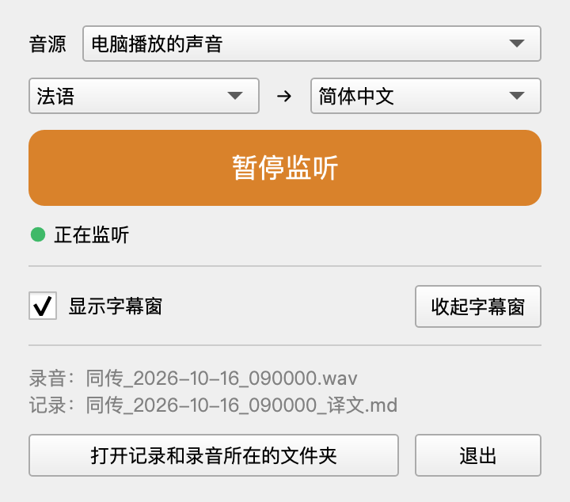

# Simultaneous-Interpretation

[](https://github.com/YEKESONG/Simultaneous-Interpretation/actions/workflows/tests.yml)

实时同声传译工具。采集电脑正在播放的声音，在本地用 Whisper 识别法语，调用大语言模型翻译成中文，以透明悬浮字幕显示在屏幕上。

**macOS** · [Windows](README.windows.md)


## 功能

- 采集系统声音，不改变声音输出，耳机和扬声器均可正常收听
- 本地流式语音识别（Whisper large-v3-turbo，基于 MLX）
- 边说边译：原文出现约 1 秒后显示译文草稿，整句结束后替换为正式译文
- 悬浮字幕窗：始终置顶，支持回看历史、收起、调整大小和字号
- 控制面板：开始 / 暂停监听，运行中切换源语言（法、英、西、德、意、葡）和目标语言
- 自动保存会话记录（Markdown）和录音（WAV），记录中标注每段在录音中的时间点



## 系统要求

| 项目 | 要求 |
|---|---|
| 设备 | Apple 芯片 Mac（M1 及以上），不支持 Intel Mac |
| 系统 | macOS 14.2 及以上（开发和测试环境为 macOS 26） |
| 磁盘空间 | 约 5 GB（开发工具、Python 环境约 1.6 GB、识别模型约 1.6 GB） |
| 网络 | 安装时下载约 2–3 GB；运行时识别在本地完成，翻译需要联网 |
| 翻译服务 | 兼容 OpenAI 接口的 API，默认 DeepSeek（需要 API 密钥，按量计费）。不配置时只显示原文 |

## 安装

以下命令在“终端”中逐条执行（⌘ + 空格，搜索“终端”）。需要密码时输入 Mac 的登录密码，输入过程中屏幕不显示字符。完整安装约需 20–40 分钟，主要是下载时间。

### 1. 安装 Xcode Command Line Tools

提供 `git` 和 Swift 编译器（用于编译系统声音采集程序），不需要安装完整的 Xcode。

```bash
xcode-select --install
```

在弹出的窗口中点击“安装”。如果提示 `command line tools are already installed`，跳过此步。

### 2. 安装 Homebrew

```bash
/bin/bash -c "$(curl -fsSL https://raw.githubusercontent.com/Homebrew/install/HEAD/install.sh)"
```

安装结束后，按终端输出的 “Next steps” 把 Homebrew 加入 `PATH`。Apple 芯片 Mac 上通常是：

```bash
echo 'eval "$(/opt/homebrew/bin/brew shellenv)"' >> ~/.zprofile
eval "$(/opt/homebrew/bin/brew shellenv)"
```

验证：

```bash
brew --version
```

已经安装过 Homebrew 的跳过此步。

### 3. 安装 Python 3.12 和 ffmpeg

```bash
brew install python@3.12 ffmpeg
```

项目需要 Python 3.11 及以上，系统自带的 Python 3.9 不能用。ffmpeg 是可选依赖，只在用 mp3、m4a 等音频文件测试时需要。

验证（应输出 `Python 3.12.x`）：

```bash
python3.12 --version
```

### 4. 获取源码

```bash
cd ~
git clone https://github.com/YEKESONG/Simultaneous-Interpretation.git
cd Simultaneous-Interpretation
```

项目位于 `~/Simultaneous-Interpretation`。后续命令都在这个目录下执行；新开终端窗口时先运行 `cd ~/Simultaneous-Interpretation`。

### 5. 创建虚拟环境并安装依赖

```bash
python3.12 -m venv .venv
.venv/bin/pip install -r requirements.txt
```

依赖安装在项目内的 `.venv` 目录中，不影响系统中的其他 Python 环境。

可选：运行测试确认环境正常（最后一行为 `N passed`，没有 `failed`）：

```bash
.venv/bin/python -m pytest
```

### 6. 下载语音识别模型

```bash
.venv/bin/hf download mlx-community/whisper-large-v3-turbo
```

模型约 1.6 GB，保存在 `~/.cache/huggingface/`。程序不会自动下载模型，没有下载时启动会报错并提示这条命令。输出中的 `unauthenticated requests` 警告可以忽略。

中国大陆网络可以使用镜像：

```bash
HF_ENDPOINT=https://hf-mirror.com .venv/bin/hf download mlx-community/whisper-large-v3-turbo
```

### 7. 配置翻译 API 密钥

1. 在 [DeepSeek 开放平台](https://platform.deepseek.com) 注册并充值；
2. 在 API keys 页面创建密钥（以 `sk-` 开头，只显示一次）；
3. 把密钥写入项目根目录的 `.env` 文件：

```bash
cp .env.example .env
open -e .env
```

把 `DEEPSEEK_API_KEY=` 改为 `DEEPSEEK_API_KEY=sk-xxxxxxxx`（不加引号和空格），保存。

`.env` 已列入 `.gitignore`，不会被提交。跳过此步程序也能运行，但只显示原文。使用其他翻译服务见[更换翻译服务](#更换翻译服务)。

### 8. 检查系统声音采集并授予权限

在浏览器中播放任意有声音的视频，然后运行：

```bash
.venv/bin/python -m simul_interp record --seconds 10
```

首次运行会编译采集程序 `si-audio-tap`，并弹出系统录音权限请求，点击“允许”。正常时终端每秒输出一行音量（dBFS，越接近 0 越响），录音保存在 `recordings/`。没有任何声音播放时系统不发送音频数据，计时会暂停。

如果音量一直在 -120 dBFS 左右，或提示“整段都是静音”：打开“系统设置 → 隐私与安全性 → 屏幕与系统录音”，在“仅系统录音”中开启 `si-audio-tap`，然后重新运行。

### 9. 启动

```bash
.venv/bin/python -m simul_interp
```

首次启动加载模型需要几秒，之后出现控制面板和字幕窗。

以后也可以在访达中双击项目目录下的 `启动同传.command` 启动。启动时会打开一个显示运行日志的终端窗口，关闭这个窗口会结束程序。

## 使用

### 控制面板

- 语言：左侧选择源语言（法、英、西、德、意、葡），右侧选择目标语言。运行中切换，从下一句生效，会话记录中会插入一行说明。这里的选择只对本次运行有效，默认值在[配置文件](#配置)中设置。
- 开始 / 暂停监听：暂停期间不识别、不翻译、不录音；继续后记录中插入“暂停后从这里继续”。
- 字幕窗：显示 / 隐藏，收起 / 展开。
- 文件：显示本次的记录和录音文件名，可以打开所在文件夹。
- 关闭面板窗口不会退出程序，可以从字幕窗右键菜单或菜单栏的“译”图标重新打开。退出请点击“退出”。

### 字幕窗

| 操作 | 方法 |
|---|---|
| 移动 | 拖动窗口中部 |
| 调整大小 | 拖动任意边或角。鼠标悬停时显示边框和右下角拉手 |
| 调整字号 | 右上角 A− / A+（鼠标悬停时显示）；⌘ + 滚轮；触控板双指捏合 |
| 回看历史 | 滚轮或触控板双指滑动，或拖动右侧滑动条；点击顶部“回到最新”返回 |
| 收起 | 点击右上角“–”收起为小条，点击小条展开 |
| 背景深浅、鼠标穿透、清空、重新连接音频设备 | 右键菜单 |

字幕窗底部是当前句：原文中白色为已确认、灰色为待确认；下方是实时更新的译文草稿（颜色较暗），整句结束后替换为正式译文并移入上方历史。右上角圆点变绿表示检测到语音。开启鼠标穿透后，从菜单栏“译”图标关闭。窗口位置、大小、字号和背景透明度会自动保存。

### 会话记录与录音

每次运行生成两个同名文件：

| 文件 | 内容 |
|---|---|
| `transcripts/同传_<日期>_<时间>_译文.md` | 原文和正式译文。每段前的 `[mm:ss]` 是该段在录音中的位置，通常比实际开始早 1 秒以内 |
| `recordings/同传_<日期>_<时间>.wav` | 系统声音录音，16 kHz 单声道，约 115 MB/小时。只记录有声音输出的时段 |

保存位置可以在[配置文件](#配置)中修改。录制他人发言前请征得对方同意。

### 命令行

在项目目录下执行：

| 命令 | 说明 |
|---|---|
| `.venv/bin/python -m simul_interp` | 启动（等同于 `run`） |
| `.venv/bin/python -m simul_interp run --paused` | 启动后暂不监听 |
| `.venv/bin/python -m simul_interp run --no-recording` | 本次不保存录音 |
| `.venv/bin/python -m simul_interp run --no-translate` | 只识别，不翻译 |
| `.venv/bin/python -m simul_interp run --ui console` | 不显示字幕窗，在终端中输出 |
| `.venv/bin/python -m simul_interp run --file <音频文件>` | 用音频文件代替系统声音（非 WAV 格式需要 ffmpeg） |
| `.venv/bin/python -m simul_interp record --seconds 10` | 录制 10 秒系统声音，检查采集是否正常 |
| `.venv/bin/python -m simul_interp config` | 显示当前生效的配置 |
| `.venv/bin/python -m simul_interp --set <段>.<项>=<值>` | 临时覆盖一项配置，例如 `--set asr.language=en` |
| `.venv/bin/python -m simul_interp --help` | 查看全部命令和参数 |

运行中按 Ctrl + C 退出。

## 配置

不修改配置也可以使用。需要修改时，复制示例配置并编辑：

```bash
cp config.example.toml config.toml
open -e config.toml
```

每一项在 `config.example.toml` 中都有注释。保存后下次启动生效；写错项名或格式时，启动会报错并指出位置；删除 `config.toml` 即恢复默认。

用“文本编辑”修改前，先在菜单“编辑 → 替换”中关闭“智能引号”，否则英文引号会被替换成弯引号，导致配置无法读取。

常用配置项：

| 配置项 | 默认值 | 说明 |
|---|---|---|
| `asr.language` | `"fr"` | 源语言：`fr`、`en`、`es`、`de`、`it`、`pt` |
| `translate.target_language` | `"简体中文"` | 目标语言 |
| `translate.glossary` | 无 | 术语表，例如 `{ "TP" = "实验课" }` |
| `translate.live_draft` | `true` | 边说边译。设为 `false` 时只显示正式译文（延迟更高，但不会出现先错后改） |
| `translate.speculative` | `true` | 句子确认前提前翻译。设为 `false` 可减少翻译请求 |
| `transcript.dir` | `"transcripts"` | 会话记录目录，可以写绝对路径 |
| `recording.dir` | `"recordings"` | 录音目录，可以写绝对路径 |
| `recording.enabled` | `true` | 是否保存录音 |
| `ui.autostart` | `true` | 启动后立即开始监听 |

### 更换翻译服务

翻译模块兼容 OpenAI Chat Completions 接口，在 `config.toml` 的 `[translate]` 中修改：

```toml
base_url = "https://api.example.com/v1"
model = "model-name"
api_key_env = "MY_API_KEY"   # 在 .env 中写 MY_API_KEY=...
extra_body = {}              # 默认值用于关闭 DeepSeek 的思考模式，其他服务改为空
```

离线使用可以在本机运行 [Ollama](https://ollama.com)，配置方法见 `config.example.toml` 中的示例（不需要密钥，对硬件要求较高）。

## 常见问题

### `zsh: command not found: brew`

Homebrew 安装后没有加入 `PATH`，运行[安装第 2 步](#2-安装-homebrew)中的两条命令。

### `zsh: command not found: python3.12`

重新运行 `brew install python@3.12`。

### `pip install` 报错，找不到 `mlx` 等包

确认是 Apple 芯片 Mac（Intel Mac 不支持），并检查 `.venv/bin/python --version` 为 3.11 及以上。版本不对时删除虚拟环境（`rm -rf .venv`）后从第 5 步重新开始。

### 下载速度慢

依赖可以使用镜像源：

```bash
.venv/bin/pip install -r requirements.txt -i https://pypi.tuna.tsinghua.edu.cn/simple
```

模型下载见[安装第 6 步](#6-下载语音识别模型)中的镜像。

### 启动时提示“本地没有找到识别模型”

完成[安装第 6 步](#6-下载语音识别模型)。

### 字幕窗没有文字

播放声音时观察右上角圆点是否变绿。如果不变绿，检查系统录音权限，见[安装第 8 步](#8-检查系统声音采集并授予权限)。字幕窗左上角的黄色文字会显示当前的错误信息。

### 只显示原文，没有译文

检查 `.env` 中的密钥和 DeepSeek 账户余额，修改后重新启动。启动日志会显示“没有设置翻译 API 密钥”或“翻译 API 密钥无效”等提示。

### 找不到控制面板

点击菜单栏的“译”图标，或右键字幕窗，选择“控制面板”。

### 切换耳机或音箱后没有字幕

macOS 上会自动重新连接。如果没有恢复，右键字幕窗，选择“重新连接音频设备”。

### 译文草稿先显示错误内容，随后又改正

草稿根据尚未确认的识别结果翻译，识别结果修正后草稿随之更新，通常 1–2 秒内稳定。不需要草稿时设置 `translate.live_draft = false`。

### 翻译费用

说话期间大约每秒发送一次翻译请求。需要降低费用时，把 `translate.live_draft` 和 `translate.speculative` 设为 `false`，代价是译文出现得更晚。

### 长时间运行后变慢

无风扇的 Mac 长时间满负荷运行会降频，识别会变慢。改善散热，或在不需要时暂停监听。

## 更新

```bash
cd ~/Simultaneous-Interpretation
git pull
.venv/bin/pip install -r requirements.txt
```

`.env`、`config.toml`、会话记录和录音不会被覆盖。

## 卸载

先备份 `transcripts/` 和 `recordings/` 中需要保留的文件，然后：

```bash
rm -rf ~/Simultaneous-Interpretation
rm -rf ~/.cache/huggingface/hub/models--mlx-community--whisper-large-v3-turbo
```

系统录音权限可以在“系统设置 → 隐私与安全性 → 屏幕与系统录音”中关闭。不再需要 Python 3.12 时运行 `brew uninstall python@3.12`。

## 工作原理

```
系统声音 ─► 语音检测 ─► 流式识别 ─► 按句切分 ─► 大模型翻译（流式）─► 透明字幕窗
   │           │            │                          │                  │
   │       Silero VAD   Whisper turbo           OpenAI 兼容 API        PySide6
   ├─ macOS：Core Audio Taps（Swift 程序 si-audio-tap）
   └─ Windows：WASAPI loopback
```

- 采集：复制一份系统音频流，不改变输出路由，因此不需要虚拟声卡。
- 识别：Whisper 不是流式模型，采用 LocalAgreement 策略：连续两次识别结果一致的部分才确认。
- 翻译：当前句每增加几个词就翻译一版草稿；整句确认后发送正式翻译，会话记录保存正式译文。句子确认前会在后台提前翻译，确认时直接使用。说话人停顿想词时留下的半句，最多等待 1.5 秒再定稿。
- 显示：底部当前句区域高度固定，原文和草稿在其中更新，不影响上方历史的位置。

### 性能

测试环境：M5 MacBook Air，Whisper large-v3-turbo，法语合成语音，DeepSeek API。

| 指标 | 中位数 | 90% |
|---|---|---|
| 法语出现在屏幕上 → 包含它的译文出现 | 1.2–1.4 s | 2.1 s |
| 一句话说完 → 正式译文开始出现 | 1.1–1.3 s | — |

其中约 0.9 s 是翻译服务返回第一个字的时间。关闭边说边译时，第一项的中位数为 2.1–2.3 s，最慢 6–7 s。详细数据见 [docs/DEVLOG.md](docs/DEVLOG.md) 的 S9–S12、S21。

## 已知问题

- 声音在半句处突然停止（例如暂停视频）时，最后半句可能被识别模型错误补全。
- 持续的类人声背景噪音中，识别模型偶尔生成不存在的短句；单独的 “Merci.” 已经过滤。
- 极轻、含糊的 “Merci.” 可能被当作噪音过滤掉。
- 从半句中间开始识别（刚启动、暂停后继续）时，识别结果有时一段时间不带标点，正式译文会延后，且单段较长。
- 翻译请求较多，见[翻译费用](#翻译费用)。
- Windows 版本尚未在实体机上验证，见 [Windows 说明](README.windows.md)。

## 开发

运行测试：

```bash
.venv/bin/python -m pytest
```

基准测试（先生成测试音频，使用 macOS 自带的合成语音）：

```bash
.venv/bin/python scripts/make_test_audio.py
.venv/bin/python -m simul_interp bench-asr samples/fr_meeting.wav
.venv/bin/python -m simul_interp bench-translate
.venv/bin/python -m simul_interp bench-pipeline samples/fr_meeting.wav --mock-translate
.venv/bin/python scripts/compare_models.py <录音.wav> --configs <模型A>:4,<模型B>:0
```

| 命令 | 测量内容 |
|---|---|
| `bench-asr` | 流式识别的延迟和准确率 |
| `bench-translate` | 翻译服务的首字延迟和整句耗时 |
| `bench-pipeline` | 端到端：法语出现到译文出现的延迟 |
| `scripts/compare_models.py` | 离线比较不同模型配置的准确率和速度 |

开发约定（提交格式、不提交的文件、Windows 验证步骤）见 [CLAUDE.md](CLAUDE.md)。项目按阶段开发，每个阶段单独提交，问题、做法和验证记录在 [docs/DEVLOG.md](docs/DEVLOG.md)。按时间顺序查看提交历史：

```bash
git log --reverse --stat
```

<details>
<summary>开发进度</summary>

- [x] S0 项目骨架与开发规范
- [x] S1 macOS 系统声音采集
- [x] S2 音频文件模拟源与测试音频
- [x] S3 语音检测与分段
- [x] S4 Whisper 流式识别
- [x] S5 流式翻译
- [x] S6 串起完整流程（终端版）
- [x] S7 透明悬浮字幕窗
- [x] S8 Windows 支持（代码和自动测试已完成，未在 Windows 真机上验证）
- [x] S9 延迟优化（测量工具、停顿时提前识别、量化选项、投机翻译）
- [x] S10 真实内录端到端验证；全程序统一高精度时钟
- [x] S11 默认 4 位量化；真实翻译 API 实测
- [x] S12 实时识别改用 turbo（对比实验后由用户决定）
- [x] S13 字幕窗改版：原文译文成对同步出现，不闪不跳
- [x] S13b 当前句区域：暂定文字只在预留的空白里更新，译文填进留白
- [x] S14 录音保存：内录时同步存一份 WAV，方便事后对照录音校对译文
- [x] S14b 会话记录里的时间改成录音里的位置
- [x] S15 杂音时段不再输出 “Merci.”（整句只有它时向识别模型核实）
- [x] S16 没说完的半句话先等一等：说话人停下来想词时不再把一句话切成两半
- [x] S17 字幕窗可以往回翻看：滚轮或右侧的滑动条，回看时眼前的内容不动
- [x] S18 字幕窗可以收起成一个小条，点一下再展开
- [x] S19 流水线支持暂停 / 继续，以及运行中换语言（法、英、西、德、意、葡 → 任意目标语言）
- [x] S20 应用前端：控制面板（换语言、开始 / 暂停监听、管理字幕窗），双击就能启动
- [x] S21 边说边译：话还没说完就出中文草稿，看到法语之后约 1 秒就能看到中文（原来要等整句说完）
- [x] S22 字幕窗任意边角都能拖动改大小，文字跟着重新排满；字号直接在字幕窗上调（A− / A+、⌘ + 滚轮、双指捏合）
- [x] S23 README 改成从零开始的安装和使用教程（在全新的环境里照着做了一遍）
- [x] S24 README 按常见格式重写（macOS），新增 Windows 版 README

</details>
