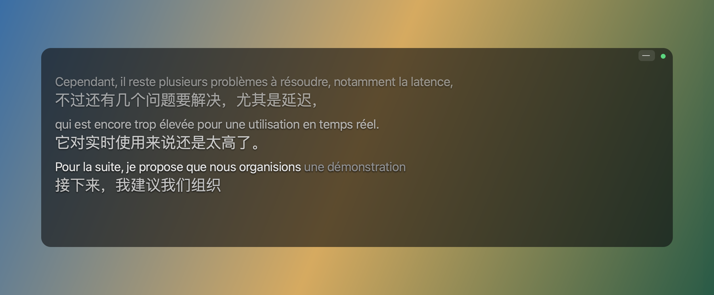

# Simultaneous-Interpretation（Windows）

[](https://github.com/YEKESONG/Simultaneous-Interpretation/actions/workflows/tests.yml)
[](LICENSE)

实时同声传译：采集电脑正在播放的声音，在本地用 Whisper 识别法语，用大模型翻译成中文，显示在透明悬浮字幕窗中。

[macOS](README.md) · **Windows**



## 要求

- Windows 10 / 11（64 位）
- 推荐 NVIDIA 显卡（CUDA 12）；只用 CPU 时识别难以跟上语速
- 约 6 GB 磁盘空间
- 翻译 API 密钥（可选，默认 [DeepSeek](https://platform.deepseek.com)；不配置时只显示原文）

## 安装

以下命令在 PowerShell 中执行。

### 1. 安装 Python 和 Git

```powershell
winget install -e --id Python.Python.3.12
winget install -e --id Git.Git
```

安装后重新打开 PowerShell。

### 2. 下载项目并安装依赖

```powershell
git clone https://github.com/YEKESONG/Simultaneous-Interpretation.git
cd Simultaneous-Interpretation
py -3.12 -m venv .venv
.venv\Scripts\pip install -r requirements.txt
```

### 3. 配置 GPU（可选）

安装最新的 [NVIDIA 驱动](https://www.nvidia.com/Download/index.aspx)，再把 CUDA 12 的 cuBLAS 和 cuDNN 9 装进虚拟环境（约 1 GB；不需要另装 CUDA Toolkit，已经装了 13 版也不影响）：

```powershell
.venv\Scripts\pip install nvidia-cublas-cu12 "nvidia-cudnn-cu12>=9,<10"
```

检查（输出大于 0 即可）：

```powershell
.venv\Scripts\python -c "import ctranslate2; print(ctranslate2.get_cuda_device_count())"
```

没有 NVIDIA 显卡时，在 `config.toml` 中设置 `[asr]` 的 `device = "cpu"`、`compute_type = "int8"`（见[配置](#配置)）。

### 4. 下载识别模型（约 1.6 GB）

```powershell
.venv\Scripts\hf download mobiuslabsgmbh/faster-whisper-large-v3-turbo
```

中国大陆网络可先运行 `$env:HF_ENDPOINT = "https://hf-mirror.com"`。

### 5. 配置翻译密钥

```powershell
copy .env.example .env
notepad .env
```

填入 `DEEPSEEK_API_KEY=sk-...` 并保存。

### 6. 检查并启动

播放任意有声音的视频，运行：

```powershell
.venv\Scripts\python -m simul_interp record --seconds 10
```

终端每秒输出一行音量即为正常（不需要授权）。启动：

```powershell
.venv\Scripts\python -m simul_interp
```

以后也可以双击项目目录中的 `启动同传.bat` 启动。

## 使用

启动后出现控制面板和字幕窗。控制面板用于开始 / 暂停监听和切换语言；关闭面板不会退出程序，可以从任务栏通知区域的“译”图标重新打开。

| 字幕窗 | 操作 |
|---|---|
| 移动 / 调整大小 | 拖动窗口中部 / 拖动边或角 |
| 字号 | 右上角 A− / A+，或 Ctrl + 滚轮 |
| 回看历史 | 滚轮，或拖动右侧滑动条 |
| 收起 | 右上角“–” |
| 背景、鼠标穿透等 | 右键菜单 |

切换耳机或音箱后，右键字幕窗选择“重新连接音频设备”。

会话记录保存在 `transcripts\`，录音保存在 `recordings\`；记录中每段前的 `[mm:ss]` 对应录音中的位置。录制他人发言前请征得同意。

常用参数：`--paused` 启动后暂不监听，`--no-recording` 不录音，`--ui console` 只在终端输出。全部参数见 `.venv\Scripts\python -m simul_interp --help`。

## 配置

```powershell
copy config.example.toml config.toml
```

各项说明见文件中的注释。路径请用正斜杠，例如 `dir = "D:/同传记录"`。翻译服务可以换成任何兼容 OpenAI 接口的服务，或本地的 [Ollama](https://ollama.com)。

## 常见问题

| 问题 | 解决方法 |
|---|---|
| `py` 或 `git` 不是内部或外部命令 | 重新打开 PowerShell；仍然不行时重新安装 |
| 提示本地没有找到模型 | 完成安装第 4 步 |
| 下载模型时提示 symlinks、Developer Mode | 可以忽略，模型照常下载，只是多占一点磁盘 |
| 找不到 `cublas64_12.dll` 或 `cudnn*64_9.dll` | 完成安装第 3 步的 `pip install`，或改用 CPU |
| 识别跟不上语速 | 确认 GPU 可用（安装第 3 步的检查命令） |
| 只有原文，没有译文 | 检查 `.env` 中的密钥和账户余额 |
| 依赖下载慢 | `pip install` 加 `-i https://pypi.tuna.tsinghua.edu.cn/simple` |

## 更新与卸载

```powershell
git pull
.venv\Scripts\pip install -r requirements.txt
```

卸载时删除项目目录和 `%USERPROFILE%\.cache\huggingface\hub\models--mobiuslabsgmbh--faster-whisper-large-v3-turbo`。

工作原理见 [macOS 版 README](README.md#工作原理)。

## 许可证

[GPL-3.0](LICENSE)。可以自由使用、修改和再发布（包括商用），但发布修改后的版本时必须同样以 GPL-3.0 公开源代码。
